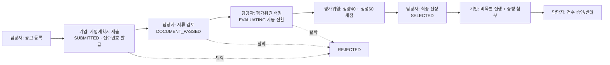

# 🏢 D-PMS (Daegu Project Management System)
> **대구형 공공 R&D·창업 지원사업 통합관리 및 e-정산 시스템**  
> **전자정부 표준프레임워크(eGovFrame) 5.0** 실행환경 기반 공공 SI 포트폴리오 프로젝트

[](https://github.com/gwangco/daegu-pms/actions/workflows/ci.yml)
[](https://www.egovframe.go.kr)
[-ED8B00?logo=openjdk&logoColor=white)](https://adoptium.net/)
[](https://spring.io/projects/spring-boot)
[](https://mybatis.org/mybatis-3/)
[](https://spring.io/projects/spring-security)
[](https://maven.apache.org/)
[](#-6-실행과-테스트)

> ⚠️ 취업 포트폴리오용 데모입니다. 등장하는 기관명·사업명·기업명은 지역 맥락을 설명하기 위한 가상의 예시이며 실제 기관과 관련이 없습니다.

---

## 📌 1. 프로젝트 소개
대구의 미래신산업(모빌리티·로봇·AI·디지털헬스케어) 지원사업을 대상으로
**공고 → 온라인 신청 → 서류 검토 → 외부 평가위원 채점 → 최종 선정 → 사업비 집행·증빙 e-정산**의 전 과정을 하나의 웹 시스템으로 구현했습니다.

공공 SI 현장에서 쓰는 방식 그대로 **전자정부 표준프레임워크 5.0 실행환경(org.egovframe.rte)** 위에서 개발했습니다.

---

## 🏛️ 2. 전자정부 표준프레임워크 적용 내역

| eGovFrame 구성요소 | 적용 내용 | 관련 코드 |
| :--- | :--- | :--- |
| **Boot 부모 POM** `egovframe-boot-starter-parent:5.0.2` | Spring Boot 3.5.6·Spring 6.2·eGov 모듈 버전 일괄 관리 | `pom.xml` |
| **공통기반** `EgovAbstractServiceImpl` | 모든 ServiceImpl 이 상속 (messageSource·LeaveaTrace 연동) | `*/service/impl/*ServiceImpl` |
| **Data Access** `@EgovMapper` + MyBatis | Mapper 인터페이스 스캔, `*_SQL.xml` 매핑 | `config/EgovConfigMapper` |
| **선언적 트랜잭션 (AOP)** | `@Transactional` 없이 포인트컷으로 ServiceImpl 전체 적용 (`select*` 읽기 전용, 체크 예외 롤백) | `config/EgovConfigTransaction` |
| **예외 후처리** `ExceptionTransfer` | 서비스 장애 로그·후처리기, 업무 예외는 제외하도록 커스터마이징 | `config/EgovConfigAspect` |
| **Property** `EgovPropertyService` | 페이징 설정값(pageUnit/pageSize) | `config/EgovConfigProperties` |
| **ID Generation** `EgovTableIdGnrServiceImpl` | 신청 접수번호 `DPMS-00000001`, 공지 ID `NTC_0000000001` | `config/EgovConfigIdGeneration` |
| **Pagination** `PaginationInfo` + `AbstractPaginationRenderer` | eGov 페이징 계산 + Bootstrap 렌더러(Thymeleaf Dialect) | `cmm/pagination` |
| **표준 패키지 구조** | 업무별 `service`(인터페이스·VO) / `service.impl`(구현·Mapper) / `web`(컨트롤러) | `src/main/java` |
| **VS Code 확장 CRUD 코드 생성기** | DDL → 공지사항 CRUD 뼈대 생성 후 보안·업무 규칙 보완 | [`docs/egov-codegen`](docs/egov-codegen/README.md) |
| **로깅** Log4j2 | eGov 실행환경 표준 로깅 구현체 | `log4j2-spring.xml` |
| **업무 메시지** `MessageSource` | UTF-8 번들 + `AppMessages`, 런타임 업무·권한·404 예외 분류 유지 | `cmm/message`, `egovframework/message` |

> Spring Boot 단독 구성에서 eGovFrame 5.0 으로 전환한 과정은 [docs/EGOVFRAME_MIGRATION.md](docs/EGOVFRAME_MIGRATION.md) 에 정리했습니다.
> 이후 메시지 외부화와 심사·정산 보안 개선은 [4차 스프린트 학습 문서](docs/SPRINT4_MESSAGES_SECURITY.md)에서 코드 흐름과 검증 방법을 설명합니다.

---

## 🔄 3. 업무 프로세스와 상태머신



* 각 상태에서 **허용된 다음 상태로만** 이동 (`ApplicationStatus`), 채점이 모두 끝나야 최종 선정 가능
* 공고 접수 마감은 매일 자정 배치(`@Scheduled`)가 자동 처리

---

## 🚀 4. 주요 기능

| 영역 | 구현 내용 |
| :--- | :--- |
| **인증·인가** | 4단계 권한(관리자/담당자/평가위원/기업), BCrypt, URL + `@PreAuthorize` + 서비스 계층 소유자 검사의 3중 인가 |
| **공지사항** | eGov 코드 생성기 기반 CRUD, 중요 공지 상단 고정, 논리 삭제, 수정 이력(수정자·일시) |
| **공고** | 공통코드 기반 분야 필터·검색, eGov 표준 페이징, 등록 폼 검증 |
| **신청** | 사업계획서 첨부, 접수기간·최대지원금·중복신청 검증, **eGov IdGnr 접수번호 발급** |
| **심사·평가** | 평가위원 배정, 평가위원 전용 채점 화면, 제출 후 수정 불가, 평균 점수 |
| **e-정산** | 비목별 집행 등록(증빙 필수), 부가세 서버 계산, 협약 지원금 초과 차단(행 잠금), 반려 사유 필수 |
| **파일** | 확장자 화이트리스트 + 파일 시그니처 검사, UUID 저장명, 경로 조작 차단, 다운로드 권한 재검사 |
| **배치·엑셀·대시보드** | 공고 자동 마감, Apache POI 엑셀, 전략산업별 예산 차트, 최근 공지 |

---

## 🛡️ 5. 보안 설계 (행정안전부 SW 개발보안 가이드 관점)

| 취약점 | 대응 |
| :--- | :--- |
| SQL 삽입 | MyBatis `#{}` 바인딩만 사용 |
| XSS | Thymeleaf `th:text` 자동 이스케이프 (`th:utext` 는 서버가 만든 페이지 번호 HTML 에만 사용) |
| 부적절한 인가(IDOR) | 서비스 계층에서 데이터 소유자·배정 여부 재검사 → 타 기업 신청서·정산·파일 403 |
| 대량 할당 | `@InitBinder` 로 소유자·금액·접수번호·감사 컬럼 등 서버 결정 필드 바인딩 차단 |
| 위험한 파일 업로드 / 경로 조작 | 화이트리스트 + 매직넘버 검사, 확장자 없는 UUID 저장, `normalize()` 후 루트 이탈 검사 |
| CSRF | Spring Security CSRF 토큰 (상태 변경은 모두 POST) |
| 오류 정보 노출 | 스택트레이스 비노출, eGov ExceptionTransfer 가 DB 예외를 일반 메시지로 변환 |
| 동시성 | 심사 상태 변경·평가 배정·채점·정산이 신청서 행을 `SELECT … FOR UPDATE`로 잠금, 검수·채점은 상태 조건부 UPDATE |
| 금액 무결성 | 공급가액 양수 검사 + `Math.addExact`로 합계 오버플로 차단, 잔액 검증 후 저장 |
| 로그 노출 | 업무/Mapper 기본 INFO, SQL 바인딩 값 비노출 회귀 테스트 (사업계획·평가 의견·정산 적요) |
| 공급망 | Maven Wrapper SHA-256 검증, GitHub Actions 커밋 SHA 고정·최소 권한, 미사용 라이브러리(iBATIS 2, JPA API) 제외 |

---

## 💻 6. 실행과 테스트

### 요구사항
* JDK 17 (Maven·DB·WAS 설치 불필요: Maven Wrapper, 내장 H2, 내장 Tomcat)

VS Code의 확장·JDK 설정과 실행 방법은 [VS Code 개발 환경 안내](docs/VS_CODE_SETUP.md)를 참고하세요.

```bash
# 실행 (Windows)
.\mvnw.cmd spring-boot:run
# 실행 (Mac / Linux)
./mvnw spring-boot:run

# 테스트
./mvnw verify
```

* 웹 포털: http://localhost:8080
* H2 콘솔: http://localhost:8080/h2-console (`admin` 로그인 후 / `jdbc:h2:mem:daegupms` / `sa` / 비밀번호 없음)

### 테스트 (78건)
* 단위: 상태머신, 파일명 정제, eGov 페이지 렌더러, 예외 후처리 분류
* 통합(MockMvc): IDOR·CSRF·권한, 파일 위조 차단, 예산 초과, 상태머신, 채점 중복 제출, 접수번호 채번, 공지 CRUD·XSS, **eGov 실행환경 구성(트랜잭션 규칙·Mapper·Property·메시지)**
* GitHub Actions 가 Pull Request 마다 자동 실행
* 4차 추가 20건: 메시지 6, 실제 DB 동시성 4, 서비스 직접 인가 4, 정산 금액 경계값 5, SQL 로그 비노출 1

이 구성은 H2 인메모리 DB와 공개된 샘플 계정을 쓰는 로컬 데모입니다. 운영 DB/Flyway, 개인정보 암호화·마스킹, 로그인 실패 잠금, 감사 이력은 후속 작업이며 운영 배포 완료를 의미하지 않습니다.

### 테스트 계정 (로컬 데모 전용)

| 권한 | 계정 ID | 비밀번호 |
| :--- | :--- | :--- |
| 총괄관리자 | `admin` | `admin1234` |
| 사업담당자 | `manager1` | `manager1234` |
| 평가위원 | `evaluator1`, `evaluator2` | `eval1234` |
| 기업회원 | `company1`, `company2` | `company1234` |

---

## 📂 7. 프로젝트 구조 (eGovFrame 표준 패키지)
```text
kr.go.daegu.pms
├── config/                  # Security, EgovConfig*(Common·Mapper·Transaction·Aspect·Properties·IdGeneration·Web)
├── cmm/                     # 공통: exception, pagination, util, web, service(ComDefaultVO·공통코드·파일)
├── notice/                  # 공지사항   ─┐
├── announcement/            # 지원사업 공고 │  각 업무 패키지 구조
├── application/             # 과제 신청   │   ├── service/        인터페이스, VO
├── evaluation/              # 평가       │   ├── service/impl/   ServiceImpl, @EgovMapper
├── settlement/              # 사업비 정산 │   └── web/            Controller
└── user/                    # 사용자/인증 ─┘
resources/
├── egovframework/sqlmap/    # sql-mapper-config.xml, mappers/*_SQL.xml
├── egovframework/message/   # 메시지 번들
├── templates/               # Thymeleaf
└── schema.sql / data.sql / application.yml / log4j2-spring.xml
docs/                        # eGov 전환 기록, 코드 생성기 원본·검토 기록
```

변경 이력은 [CHANGELOG.md](CHANGELOG.md) 를 참고하세요.

---

## 📜 8. 라이선스
교육 및 포트폴리오 목적으로 제작되었습니다. © 2026 gwangco
