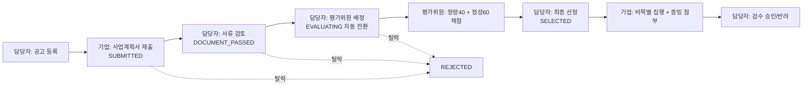

# 🏢 D-PMS (Daegu Project Management System)
> **대구형 공공 R&D·창업 지원사업 통합관리 및 e-정산 시스템**  
> 전자정부 표준프레임워크의 아키텍처 규칙(Controller–Service 인터페이스/Impl–Mapper, 공통코드, 표준 페이징)을 Spring Boot 3 위에 적용한 공공 SI 포트폴리오 프로젝트

[-ED8B00?logo=openjdk&logoColor=white)](https://adoptium.net/)
[](https://spring.io/projects/spring-boot)
[](https://mybatis.org/mybatis-3/)
[](https://spring.io/projects/spring-security)
[](https://poi.apache.org/)
[](https://mariadb.org/)
[](#-6-테스트)

> ⚠️ 본 프로젝트는 취업 포트폴리오용 데모이며, 등장하는 기관명·사업명·기업명은 지역 맥락을 설명하기 위한 가상의 예시로 실제 기관과 관련이 없습니다.

---

## 📌 1. 프로젝트 기획 배경
대구에는 대구테크노파크, 대구디지털혁신진흥원 등 지역 미래신산업(모빌리티·로봇·AI·디지털헬스케어) 육성을 위한 공공 지원기관이 밀집해 있습니다.  
**지원사업 공고 → 온라인 신청 → 서류 검토 → 외부 평가위원 온라인 채점 → 최종 선정 → 사업비 비목별 집행 및 증빙 e-정산**의 전 과정을 하나의 웹 시스템으로 구현했습니다.

---

## 🏛️ 2. 업무 프로세스와 상태머신



* 각 상태에서 **허용된 다음 상태로만** 이동 가능 (`ApplicationStatus` enum). 탈락 → 선정 같은 역행, 심사 건너뛰기 차단
* 배정된 평가위원의 채점이 **모두 완료되어야** 최종 선정 가능
* 공고 접수 마감은 매일 자정 배치(`@Scheduled`)가 자동 처리

---

## 🚀 3. 주요 기능

| 영역 | 구현 내용 |
| :--- | :--- |
| **인증·인가** | Spring Security 4단계 권한(관리자/담당자/평가위원/기업), BCrypt 비밀번호, URL + `@PreAuthorize` + 서비스 계층 소유자 검사의 3중 인가 |
| **공고** | 공통코드 기반 분야 필터·검색, **전자정부 표준 페이징**(`PaginationInfo` 방식, 10건/10페이지 블록), Bean Validation 등록 폼 |
| **신청** | 사업계획서 파일 첨부, 접수기간·최대지원금·중복신청 서버 검증, 자부담금 서버 재계산 |
| **심사·평가** | 평가위원 배정, 평가위원 전용 채점 화면, 제출 후 수정 불가, 평균 점수 집계 |
| **e-정산** | 비목별 집행 등록(증빙 필수), 부가세 서버 계산, **협약 지원금 초과 집행 차단(행 잠금)**, 반려 사유 필수, 검수자 기록 |
| **파일** | 확장자 화이트리스트 + 파일 시그니처 검사, UUID 저장명, 경로 조작 차단, 다운로드 시 권한 재검사 |
| **배치** | 접수 마감일이 지난 공고 자동 마감 (매일 자정 + 서버 기동 시 1회) |
| **엑셀** | Apache POI로 신청 현황 `.xlsx` 다운로드 (검색 조건 유지, 평균 점수 포함) |
| **대시보드** | 접수중 공고/신청/선정 KPI, 전략산업별 예산 배분 차트(DB 집계) |

---

## 🛡️ 4. 보안 설계 (행정안전부 SW 개발보안 가이드 관점)

| 취약점 | 대응 |
| :--- | :--- |
| SQL 삽입 | MyBatis `#{}` 파라미터 바인딩만 사용 (`${}` 미사용) |
| XSS | Thymeleaf `th:text` 자동 이스케이프, JS 데이터는 `th:inline="javascript"` |
| 부적절한 인가(IDOR) | `ApplicationAccessChecker`가 데이터 조회 후 소유자/배정 여부 재검사 → 타 기업 신청서·정산·첨부파일 403 |
| 대량 할당 | `@InitBinder`로 소유자·금액·페이징 등 서버 결정 필드 바인딩 차단 |
| 위험한 파일 업로드 | 확장자 화이트리스트 + 매직넘버 검사, 확장자 없는 UUID 저장, 응답은 항상 `octet-stream` |
| 경로 조작 | 원본 파일명은 표시용으로만 사용, 저장 경로 `normalize()` 후 업로드 루트 이탈 검사 |
| CSRF | Spring Security CSRF 토큰 (H2 콘솔만 예외) |
| 비밀번호 저장 | `{bcrypt}` 단방향 해시 |
| 오류 정보 노출 | 스택트레이스/예외 메시지 비노출, 공통 오류 화면 |
| 관리 도구 노출 | H2 콘솔은 `local` 프로필 + 관리자 권한 + localhost 전용 |
| 동시성 | 정산 등록 시 `SELECT … FOR UPDATE`, 검수·채점은 상태 조건부 `UPDATE`로 중복 처리 차단 |

---

## 🔑 5. 테스트 계정

> 로그인 화면 하단의 빠른 입력 버튼으로 바로 체험할 수 있습니다. (로컬 데모 전용 계정)

| 권한 | 계정 ID | 비밀번호 | 체험 시나리오 |
| :--- | :--- | :--- | :--- |
| 총괄관리자 | `admin` | `admin1234` | 전체 조회, H2 콘솔 |
| 사업담당자 | `manager1` | `manager1234` | 공고 등록, 서류 검토, 평가위원 배정, 선정, 정산 검수, 엑셀 |
| 평가위원 | `evaluator1`, `evaluator2` | `eval1234` | 배정 과제 채점 (`/evaluator/evaluations`) |
| 기업회원 | `company1`, `company2` | `company1234` | 사업 신청, 선정 과제 사업비 집행 등록 |

---

## 💻 6. 실행 방법

### 필수 요구사항
* JDK 17 (별도 DB·WAS 설치 불필요, 내장 H2 + 내장 Tomcat)

```bash
# Windows
.\gradlew.bat bootRun
# Mac / Linux
./gradlew bootRun
```

* 웹 포털: http://localhost:8080
* H2 콘솔: http://localhost:8080/h2-console (`admin` 로그인 후 / JDBC URL `jdbc:h2:mem:daegupms` / `sa` / 비밀번호 없음)
* 첨부파일은 실행 위치의 `uploads/` 폴더에 저장됩니다 (Git 제외)

### 🧪 테스트
```bash
.\gradlew.bat test
```
* 단위 테스트: 페이징 계산, 상태머신 전이 규칙, 파일명 정제
* 통합 테스트(MockMvc): IDOR·CSRF·권한, 파일 위조 업로드 차단, 예산 초과, 상태머신, 채점 중복 제출, 배치, 화면 렌더링
* 테스트는 시계를 고정(`Clock`)해 실행 날짜와 무관하게 같은 결과를 냅니다.

---

## 📂 7. 프로젝트 구조
```text
kr.go.daegu.pms
├── batch/          # 공고 마감 스케줄러
├── common/         # 공통: 예외(BusinessException), 페이징(PaginationInfo), 검색VO, 보안 유틸, 바인딩 규칙
├── config/         # Spring Security, 앱 설정(@ConfigurationProperties), Clock
├── controller/     # 화면 요청 처리 (공고, 신청, 평가, 정산, 파일, 엑셀)
├── domain/         # VO / 상태 enum
├── mapper/         # MyBatis Mapper 인터페이스
└── service/        # 서비스 인터페이스 + ApplicationAccessChecker
    └── impl/       # 서비스 구현체 (전자정부 표준 Service/ServiceImpl 분리)
resources/
├── application.yml / application-local.yml
├── schema.sql / data.sql
├── mapper/         # MyBatis XML (공통 컬럼·조건 <sql> 재사용)
└── templates/      # Thymeleaf (fragments, error 페이지 포함)
```

---

## 📜 8. 라이선스
교육 및 포트폴리오 목적으로 제작되었습니다. © 2026 gwangco
