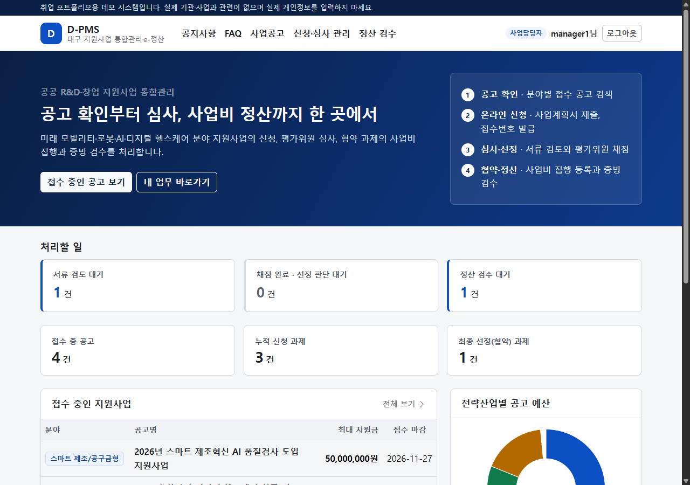
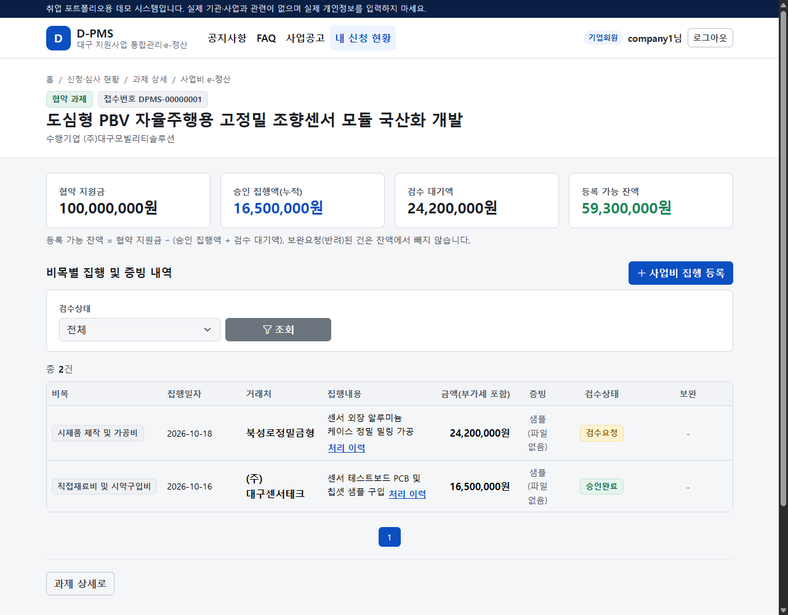
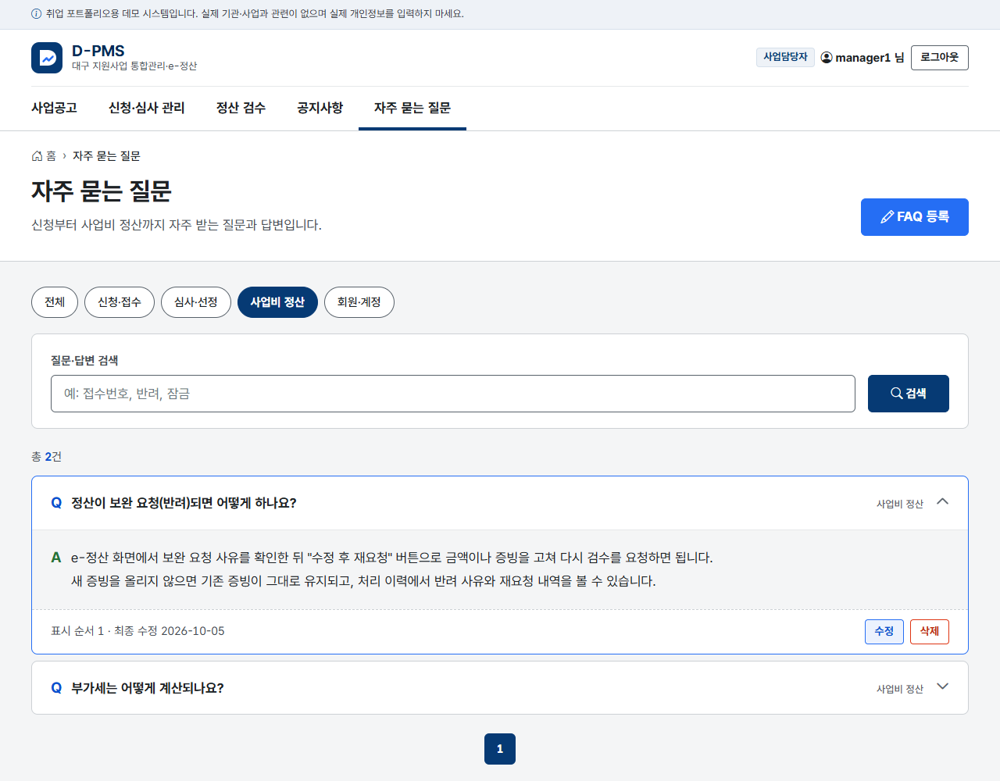
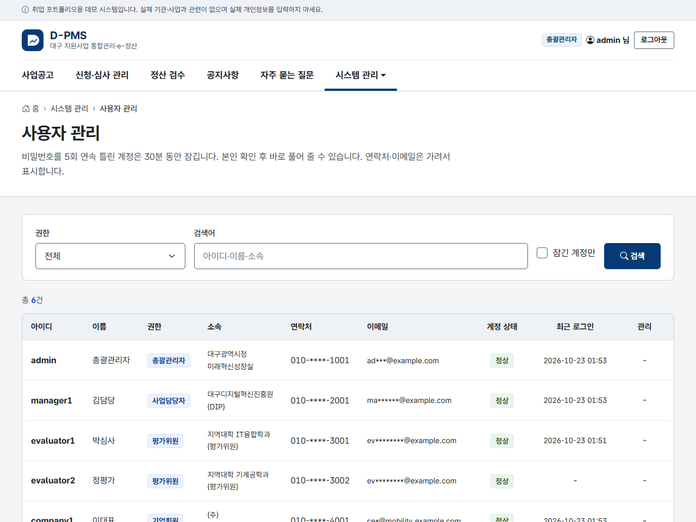
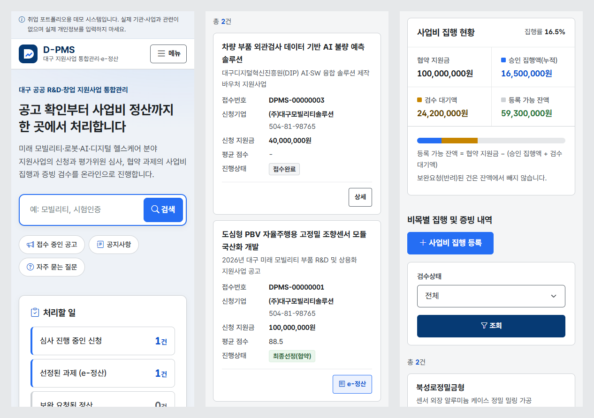
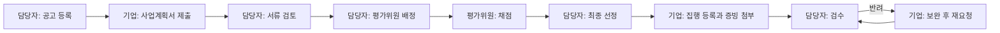

# D-PMS

대구 지원사업 관리·정산 시스템입니다. 전자정부 표준프레임워크(eGovFrame) 5.1 과 공통컴포넌트로 만든 공공 SI 포트폴리오 프로젝트입니다.

담당자가 지원사업 공고를 올리면 기업이 사업계획서를 내고, 담당자가 서류를 검토해 평가위원에게 배정합니다. 채점 결과로 선정된 기업은 사업비를 쓰고 증빙을 올리고, 담당자가 이를 검수합니다. 이 흐름을 한 시스템에서 처리합니다.

[](https://github.com/gwangco/daegu-pms/actions/workflows/ci.yml)
[](https://www.egovframe.go.kr)
[](https://adoptium.net/)
[](https://spring.io/projects/spring-boot)
[](https://dev.mysql.com/doc/relnotes/mysql/8.4/en/)
[](#테스트)

> 취업 포트폴리오용 데모입니다. 기관, 사업, 기업 이름은 모두 가상입니다.

| 메인 (사업담당자) | e-정산 (기업회원) |
| :---: | :---: |
|  |  |
| **FAQ** | **사용자 관리** |
|  |  |



## 기술 스택

- Java 17, Spring Boot 3.5.16 (eGovFrame 5.1.0 부모 POM), Spring Security
- MyBatis, MySQL 8.4, Flyway
- Thymeleaf, Bootstrap 5, KRDS 디자인 토큰
- Spring Batch (eGov 배치)
- JUnit, MockMvc, GitHub Actions, Docker Compose

## 실행

Docker 가 있으면 이 방법이 제일 간단합니다. 자세한 내용은 [DOCKER.md](docs/DOCKER.md) 에 있습니다.

```bash
cp .env.example .env          # 비밀번호 세 개를 바꿉니다
docker compose up -d --build  # http://localhost:8080
```

직접 실행하려면 JDK 17 과 MySQL 8.x 가 필요합니다.

```bash
.\scripts\setup-local-mysql.ps1   # 처음 한 번: DB, 계정, 비밀번호 파일 생성
.\mvnw.cmd spring-boot:run        # 실행 (Flyway 가 스키마와 데모 데이터를 넣습니다)
.\mvnw.cmd clean verify           # 테스트
```

개발 환경 설정은 [Eclipse](docs/ECLIPSE_SETUP.md), [VS Code](docs/VS_CODE_SETUP.md) 문서를 보면 됩니다.

### 데모 계정

| 역할 | 아이디 | 비밀번호 |
| :--- | :--- | :--- |
| 총괄관리자 | `admin` | `admin1234` |
| 사업담당자 | `manager1` | `manager1234` |
| 평가위원 | `evaluator1`, `evaluator2` | `eval1234` |
| 기업회원 | `company1`, `company2` | `company1234` |

기업회원은 `/signup` 에서 직접 가입할 수도 있습니다. 총괄관리자가 승인하면 로그인됩니다.

## 업무 흐름



신청서는 정해진 다음 상태로만 바뀌고, 배정된 평가위원이 모두 채점해야 선정할 수 있습니다. 공고 마감은 매일 자정에 배치가 처리합니다.

## 주요 기능

- 계정: 역할 4개, 로그인 5회 실패 시 30분 잠금, 접속 기록, 기업회원 가입과 관리자 승인
- 공고와 신청: 접수 기간과 최대 지원금 검증, 접수번호 채번, 임시저장과 제출 취소
- 심사: 평가위원 배정, 채점(정량 40점, 정성 60점), 최종 선정
- e-정산: 비목별 집행과 증빙, 부가세 서버 계산, 잔액 초과 차단, 반려 건 보완 후 재요청
- 공지와 FAQ: 공통컴포넌트 게시판과 FAQ, 공지 첨부파일
- 개인정보: 연락처와 이메일 암호화, 화면 마스킹, 개인정보 처리 기록
- 관리: 사용자 관리, 배치 실행 이력, 엑셀 다운로드

## eGovFrame 을 쓴 곳

- 부모 POM 으로 Spring Boot, Spring Security, eGov 모듈 버전을 관리합니다. 5.0.2 에서 5.1.0 으로 올릴 때도 부모 버전만 바꾸고 회귀 테스트로 확인했습니다.
- 모든 ServiceImpl 은 `EgovAbstractServiceImpl` 을 상속하고, Mapper 는 `@EgovMapper` 를 씁니다.
- 트랜잭션은 AOP 로 메서드 이름 규칙을 적용합니다. `select*` 는 읽기 전용입니다.
- ID Generation 으로 접수번호(`DPMS-00000001`)를 채번합니다.
- 암호화 서비스(ARIA)로 연락처와 이메일을 암호화해 저장합니다.
- `PaginationInfo`, `EgovPropertyService`, `MessageSource`, 예외 후처리, Log4j2 를 씁니다.
- 공통컴포넌트 v5.0.7 의 공통코드, 첨부파일, 게시판, FAQ 를 가져와 고쳐 썼습니다 ([사용 내역](docs/COMMON_COMPONENTS.md)).
- 공고 마감은 eGov 배치 잡으로 만들었습니다 ([11차 2부](docs/SPRINT11_EGOV_BATCH.md)).

Spring Boot 단독 구성에서 eGovFrame 으로 옮긴 과정은 [전환 기록](docs/EGOVFRAME_MIGRATION.md) 에 있습니다.

## 보안에서 신경 쓴 것

- SQL 은 `#{}` 바인딩만 쓰고, 화면은 Thymeleaf 이스케이프와 CSP(`script-src 'self'`)로 막습니다.
- 권한은 URL, `@PreAuthorize`, 서비스 세 곳에서 확인합니다. 서비스에서 "자기 신청서인가", "배정된 평가위원인가"를 다시 봅니다.
- 소유자, 금액, 감사 컬럼처럼 서버가 정해야 하는 값은 요청에서 받지 않습니다.
- 업로드 파일은 확장자와 시그니처를 검사하고, 웹 루트 밖에 UUID 이름으로 저장합니다.
- 심사, 평가, 정산은 신청서 행을 `SELECT ... FOR UPDATE` 로 잠근 뒤 검사합니다.
- DB 계정을 테이블 변경용과 실행용으로 나누고, 비밀번호는 저장소 밖에 둡니다.
- Maven Wrapper 체크섬, GitHub Actions 커밋 SHA, MySQL 이미지 digest 를 고정했습니다.

## 테스트

테스트는 249건입니다. 상태 흐름이나 비밀번호 규칙 같은 단위 테스트, 권한과 CSRF, 파일 위조, 예산 초과, 계정 잠금을 보는 MockMvc 통합 테스트, 그리고 MySQL 행 잠금 대기를 실제로 확인하는 동시성 테스트가 있습니다.

Pull Request 마다 GitHub Actions 가 MySQL 8.4 컨테이너로 테스트를 돌리고, Docker Compose 로 앱을 실제로 띄워 응답까지 확인합니다.

## 구조

```text
egovframework.com      공통컴포넌트 v5.0.7 (원본 패키지 그대로)
kr.go.daegu.pms
├── config/            Security, eGov 설정
├── cmm/               공통 (암호화, 예외, 메시지, 감사 인터셉터, 페이징)
├── announcement/      공고, 마감 배치
├── application/       신청
├── evaluation/        평가
├── settlement/        정산
├── notice/, faq/      공지사항, FAQ (공통컴포넌트 호출)
└── user/              사용자, 로그인, 가입
resources/
├── db/migration/      Flyway V1~V7 (데모 데이터는 db/seed/)
├── egovframework/     SQL 매퍼, 메시지
├── templates/         Thymeleaf 화면
└── static/            CSS(KRDS 토큰), JS, 글꼴
```

업무 패키지는 eGov 표준대로 `service/`(인터페이스, VO), `service/impl/`(ServiceImpl, Mapper), `web/`(Controller) 로 나눴습니다.

## 문서

| 회차 | 내용 |
| :--- | :--- |
| [3차](docs/EGOVFRAME_MIGRATION.md) | eGovFrame 5.0 전환 |
| [4차](docs/SPRINT4_MESSAGES_SECURITY.md) | 메시지 정리, 동시 요청과 금액 계산 보완 |
| [5차](docs/SPRINT5_ACCOUNT_PRIVACY_UI.md) | 계정 잠금, 개인정보 암호화, 화면 정리 |
| [6차](docs/SPRINT6_MYSQL_COMMON_COMPONENTS.md) | MySQL, Flyway, 공통컴포넌트 |
| [7차](docs/SPRINT7_DESIGN_RENEWAL.md) | KRDS 기준 화면 개편 |
| [8차](docs/SPRINT8_NOTICE_ATTACHMENTS.md) | 공지사항 첨부파일 |
| [9차](docs/SPRINT9_COMPANY_SIGNUP.md) | 기업회원 가입 |
| [10차](docs/SPRINT10_APPLICATION_DRAFT.md) | 신청서 임시저장, 제출 취소 |
| [11차](docs/SPRINT11_PRIVACY_ACCESS_LOG.md) | 개인정보 처리 기록 |
| [11차 2부](docs/SPRINT11_EGOV_BATCH.md) | 공고 마감 배치 |
| [12차](docs/SPRINT12_FINAL.md) | SI 산출물, 동시성 테스트 |

- SI 산출물: [테이블 정의서](docs/si/TABLE_DEFINITION.md), [ERD](docs/si/ERD.md), [화면 목록과 요구사항 추적표](docs/si/SCREEN_LIST.md)
- [공통컴포넌트 사용 내역](docs/COMMON_COMPONENTS.md), [로그인·권한 비교](docs/UAT_SEC_COMPARISON.md)
- [Docker 로 실행하기](docs/DOCKER.md), [코드 생성기 기록](docs/egov-codegen/README.md), [변경 이력](CHANGELOG.md)

## 하지 않은 것

- 비밀번호 변경과 찾기, 회원 탈퇴
- 첨부파일 바이러스 검사, 실패한 배치를 화면에서 다시 실행하기
- 로그인과 권한은 공통컴포넌트(uat, sec) 대신 Spring Security 로 직접 구성했습니다 ([이유](docs/UAT_SEC_COMPARISON.md))

화면은 KRDS 디자인 토큰(krds-uiux 1.1.0)을 참고했고, 글꼴은 KRDS 배포본의 Pretendard GOV(SIL OFL 1.1)를 씁니다. 출처와 라이선스는 [`licenses/`](licenses) 에 있습니다.
