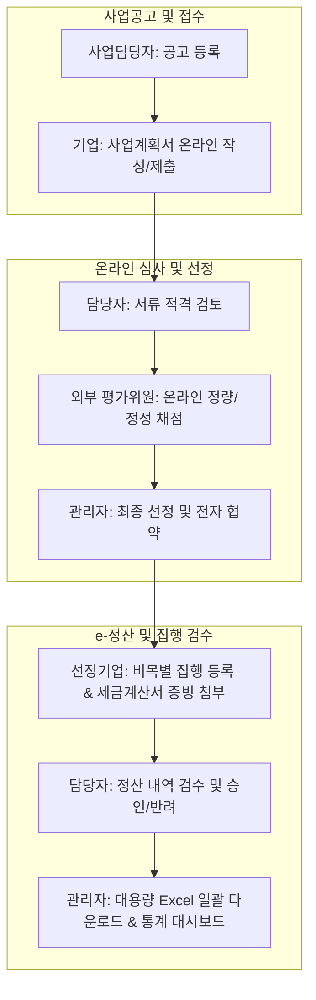

# 🏢 D-PMS (Daegu Project Management System)
> **대구형 공공 R&D·창업 지원사업 통합관리 및 e-정산 시스템**  
> 전자정부프레임워크(eGovFrame 4.x) 표준 아키텍처 및 Spring Boot 3.3 기반의 공공 엔터프라이즈 포털

[-ED8B00?logo=openjdk&logoColor=white)](https://www.oracle.com/java/)
[](https://spring.io/projects/spring-boot)
[](https://blog.mybatis.org/)
[](https://spring.io/projects/spring-security)
[](https://poi.apache.org/)
[](https://mariadb.org/)
[](https://getbootstrap.com/)

---

## 📌 1. 프로젝트 기획 배경 (Daegu Regional Context)
대구광역시에는 **대구테크노파크(대구TP)**, **대구디지털혁신진흥원(DIP)**, **대구창조경제혁신센터** 등 지역 미래신산업(모빌리티, 로봇, AI·SW, 디지털헬스케어) 육성을 위한 공공 지원기관이 밀집해 있습니다.  
기존에는 부서별로 수기 또는 분산 관리되던 **지원사업 공고 → 온라인 신청 접수 → 외부 심사위원 온라인 채점 → 최종 선정·협약 → 사업비(보조금) 비목별 집행 및 세금계산서 증빙 e-정산**의 전 과정을 단일 엔터프라이즈 표준 웹 시스템으로 구축하였습니다.

---

## 🏛️ 2. 시스템 업무 프로세스 (Workflow)



---

## 🚀 3. 핵심 기술 차별점 및 엔터프라이즈 기능

### ① 4단계 권한 분리 및 인가 (RBAC)
* `ROLE_ADMIN` (총괄관리자): 시스템 전권 및 시정 통계 모니터링
* `ROLE_MANAGER` (사업담당자): 공고 등록, 과제 심사진행, 비목별 영수증 정산 승인/반려
* `ROLE_EVALUATOR` (외부 평가위원): 배정된 과제의 사업계획서 열람 및 100점 만점 채점
* `ROLE_COMPANY` (신청기업): 공고 신청, 계획서 제출, 예산 집행 증빙 등록

### ② 엄격한 다단계 상태 머신 (State Machine) & 데이터 무결성
* 과제 진행 상태: `SUBMITTED(접수완료)` → `EVALUATING(심사중)` → `SELECTED(선정)` / `REJECTED(탈락)`
* 비목별 정산 상태: `REQUESTED(검수요청)` → `APPROVED(승인완료)` / `REJECTED(보완반려)`
* 총 협약 예산 범위 내 집행 유효성 자동 검증 (예산 초과 집행 방지 트랜잭션)

### ③ 실무 핵심 Apache POI 대용량 엑셀 다운로드
* `/excel/applications` 엔드포인트를 통해 기업별 신청 정보, 예산, 진행상태를 서식이 적용된 `.xlsx` 파일로 고속 추출 (헤더 스타일링, 숫자 콤마 포맷, 열 너비 자동 맞춤)

### ④ 전자정부 표준 공통코드 & 확장형 DB 아키텍처
* 공통코드 테이블(`com_code_group`, `com_code_detail`)을 기반으로 대구 5대 전략산업 및 5대 사업비 비목(`인건비`, `직접재료비`, `시제품제작비`, `연구활동비`, `위탁정산수수료`) 체계화
* 단일 랩탑 환경에서는 **초경량 내장 H2 Database**(메모리 30MB 미만)로 구동되며, 설정 3줄 변경으로 상용 **MariaDB / MySQL** 즉시 전환 가능

---

## 🔑 4. 사전 등록 테스트 계정 (Role-Based Accounts)

> 💡 **원클릭 체험**: 로그인 화면 하단의 빠른 입력 버튼을 클릭하면 즉시 테스트 계정 정보가 입력됩니다.

| 권한 (Role) | 계정 ID | 비밀번호 | 성명 / 소속 |
| :--- | :--- | :--- | :--- |
| **총괄관리자** | `admin` | `admin1234` | 총괄관리자 (대구광역시청 미래혁신성장실) |
| **사업담당자** | `manager1` | `manager1234` | 김담당 (대구디지털혁신진흥원 DIP) |
| **평가위원** | `evaluator1` | `eval1234` | 박심사 (경북대학교 IT대학 교수) |
| **기업회원 1** | `company1` | `company1234` | 이대표 ((주)대구모빌리티솔루션) |
| **기업회원 2** | `company2` | `company1234` | 최기술 ((주)수성AI로보틱스) |

---

## 💻 5. 로컬 실행 방법 (Quick Start)

### 필수 요구사항
* Java 17 (JDK 17 LTS)
* 별도의 DB나 웹서버(Tomcat/Node.js) 설치가 전혀 필요 없습니다.

### 실행 명령어
```bash
# 1. 저장소 복제
git clone https://github.com/gwangco/daegu-pms.git
cd daegu-pms

# 2. 프로젝트 빌드 및 실행 (Windows)
.\gradlew.bat bootRun

# (Mac / Linux)
./gradlew bootRun
```

### 접속 주소
* **D-PMS 웹 포털**: [http://localhost:8080](http://localhost:8080)
* **H2 웹 콘솔**: [http://localhost:8080/h2-console](http://localhost:8080/h2-console)  
  *(JDBC URL: `jdbc:h2:mem:daegupms`, Username: `sa`, Password: 공란)*

---

## 📂 6. 프로젝트 디렉토리 구조
```text
kr.go.daegu.pms
├── config/              # Spring Security (RBAC, CSRF, Session)
├── domain/              # User, Announcement, Application, Settlement, CommonCode
├── mapper/              # MyBatis Mapper Interface (User, Announcement, Application, Settlement)
├── service/             # 비즈니스 로직 및 Apache POI 엑셀 처리
├── controller/          # 웹 요청 매핑 및 권한별 화면 라우팅
└── resources/
    ├── application.yml  # H2 / MyBatis / Thymeleaf / Multipart 설정
    ├── schema.sql       # 7개 테이블 DDL
    ├── data.sql         # 대구 신산업 지원사업 초기 시드 데이터
    ├── mapper/          # MyBatis 동적 SQL 매핑 XML
    └── templates/       # Bootstrap 5 기반 Thymeleaf 반응형 UI
```

---

## 📜 7. 라이선스 (License)
본 프로젝트는 교육 및 포트폴리오 목적으로 제작된 오픈소스 소프트웨어입니다.
Copyright © 2026 Daegu Metropolitan City & Gwangco. All rights reserved.
