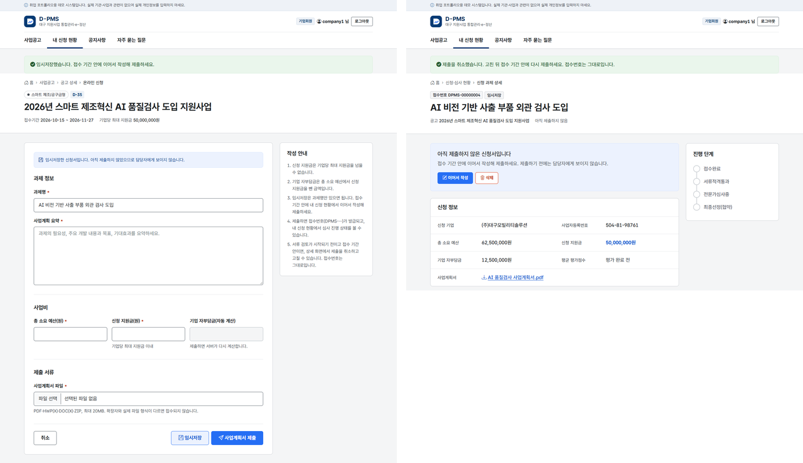

# 10차: 신청서 임시저장과 제출 취소

2026-10-23, 브랜치 `feature/sprint10-application-draft`

상태 코드에 임시저장(`TEMP_SAVED`)이 있었는데 쓰는 곳이 없었다. 이번에 기업의 신청 흐름을 작성, 임시저장, 제출, 제출 취소, 다시 제출까지 넓혔다.

- 과제명만 적고 임시저장한 뒤, 접수 기간 안에 이어서 작성해 제출한다.
- 제출한 뒤에도 서류 검토 전이고 접수 기간 안이면 제출을 취소하고 고쳐서 다시 낼 수 있다. 접수번호는 처음 받은 번호 그대로다.
- 임시저장은 신청한 기업만 본다. 담당자 목록이나 통계에는 나오지 않는다.

## 버튼 두 개, 처리 두 개

작성 화면에 "임시저장"과 "사업계획서 제출" 버튼을 두고, 컨트롤러는 `@PostMapping(params = "draft")` 와 `params = "!draft"` 로 나눴다. 임시저장은 과제명만 필수라서 Bean Validation 을 하지 않고, 제출할 때만 필수 항목과 금액, 사업계획서를 검사한다.

그런데 중복 제출을 막는 공통 스크립트가 제출 순간 버튼을 모두 비활성화했고, 비활성화된 버튼 값은 전송되지 않는다. 그래서 "임시저장"을 눌러도 제출로 처리됐다. 누른 버튼의 값을 숨은 칸에 옮겨 놓고 비활성화하도록 고쳤다.

## 임시저장은 본인만

목록은 서비스가 권한을 보고 임시저장을 뺀다. 상세는 본인이 아니면 404 로 답해서 있는지조차 알리지 않는다.

이어서 작성, 제출, 제출 취소, 삭제는 모두 신청서 행을 `FOR UPDATE` 로 잠근 뒤 본인 여부와 상태를 확인한다. 접수 기간도 화면이 보낸 공고 번호가 아니라 잠근 신청서의 공고로 확인한다.

## DB 도 한 번 더 막는다

임시저장 때문에 접수번호, 금액, 제출 일시 같은 컬럼의 NOT NULL 을 풀어야 했다. 대신 CHECK 제약을 걸어서 임시저장이 아니면 필수 항목이 모두 있어야 저장되게 했다. 서비스를 거치지 않은 UPDATE 로 빈 신청서를 접수 상태로 바꾸려 해도 DB 가 거부한다. MySQL 은 8.0.16 부터 CHECK 를 실제로 검사한다.

제약을 넣자마자 기존 테스트 5건이 실패했다. 제출 일시 기본값을 없앴더니, 기본값에 기대던 테스트 데이터의 제출 일시가 비어 버린 것이었다. 기본값은 두고 임시저장할 때만 NULL 을 넣도록 고쳤다. 제약이 실수를 바로 잡아 준 셈이다.

## 확인

- 테스트 233건 통과 (9건 추가)
- 헤드리스 Chrome 으로 기업회원이 임시저장, 이어서 작성, 제출, 제출 취소를 직접 해 보고 접수번호가 유지되는지, 담당자 목록에 임시저장이 안 보이는지 확인

## 남은 것

- 공고가 마감된 뒤에도 남는 임시저장 정리
- 제출 취소 이력을 따로 남기기
- 사업계획서 외 별첨 파일
