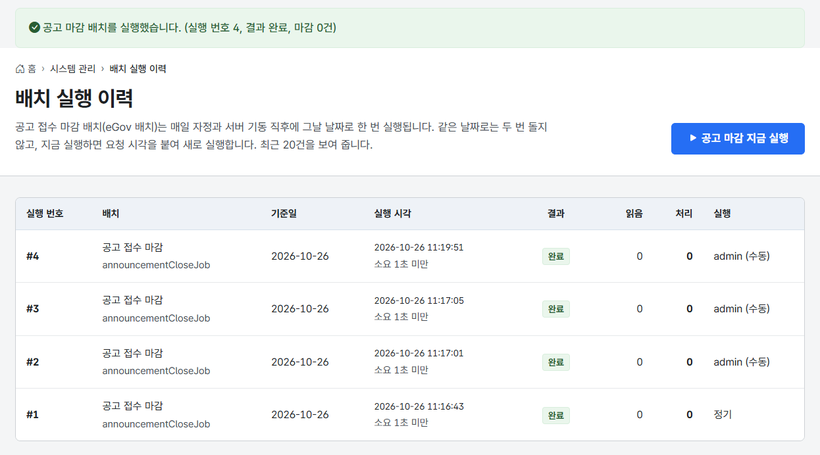

# 11차 스프린트 2부 — 공고 마감 eGov 배치

작업일: 2026-10-26 · 브랜치: `feature/sprint11-egov-batch` · 이전 문서: [11차 1부 개인정보 처리 기록](SPRINT11_PRIVACY_ACCESS_LOG.md) · 다음 문서: [12차 마감](SPRINT12_FINAL.md)

## 한눈에 보기

- 매일 자정 공고 접수 마감을 하던 UPDATE 한 번을 **eGov 배치 잡** `announcementCloseJob` 으로 바꿨다.
- 실행할 때마다 기준일, 실행 시각, 걸린 시간, 결과, 읽은 건수와 처리한 건수가 Spring Batch 메타데이터 테이블에 남는다. 총괄관리자는 시스템 관리 > **배치 실행 이력**에서 이 기록을 보고, 그 자리에서 바로 실행할 수도 있다.
- 같은 기준일로는 한 번만 돈다. 자정에 돈 뒤 서버를 다시 띄워도 다시 마감하지 않는다.



## 1. 범위

10차까지는 `@Scheduled` 메서드가 서비스의 UPDATE 를 한 번 부르는 방식으로 마감했다. 남는 결과는 "n건 전환" 로그 한 줄이었다. 그래서 언제 어떤 날짜 기준으로 돌았는지, 실패하지는 않았는지를 화면에서 확인할 수 없었다. 11차 1부에서 미룬 이 일을 eGov 배치 실행환경으로 옮겼다.

## 2. 구성

```
AnnouncementCloseScheduler  (언제 돌릴지)
 ├ 매일 자정 cron, 서버 기동 직후 → runDaily(오늘)          파라미터 targetDate
 └ 관리자 "지금 실행"             → runNow(관리자 아이디)    파라미터 targetDate, requestedAt, requestedBy(식별 제외)
        │ JobLauncher
        ▼
announcementCloseJob   잡 리스너 EgovBatchSummaryListener: 끝나면 건수 요약을 로그로
 └ announcementCloseStep   청크 100건, 트랜잭션 txManager
     읽기  EgovMyBatisPagingItemReader → selectCloseTargetAnnouncementList
     쓰기  EgovMyBatisBatchItemWriter  → updateAnnouncementClosedByBatch (JDBC 배치로 한 번에 보냄)
        │ JobRepository
        ▼
BATCH_JOB_INSTANCE, BATCH_JOB_EXECUTION(_PARAMS), BATCH_STEP_EXECUTION …   Flyway V7
        ▲ 읽기만 함 (BatchHistory_SQL.xml)
시스템 관리 > 배치 실행 이력 (/admin/batch)
```

| 파일 | 하는 일 |
| :--- | :--- |
| `pom.xml` | `egovframe-rte-bat-core` 추가. 버전은 eGov BOM(5.1.0)이 정한다 |
| `db/migration/V7__batch_metadata.sql` | Spring Batch 5.2 의 MySQL 메타데이터 테이블. spring-batch-core 안에 있는 `schema-mysql.sql` 을 그대로 옮겼다 |
| `announcement/batch/AnnouncementCloseJobConfig` | 잡, 스텝, 리더, 라이터 |
| `announcement/batch/AnnouncementCloseScheduler` | 정기·기동·수동 실행, 같은 기준일을 다시 실행할 때의 처리 |
| `Announcement_SQL.xml` | 마감 대상 읽기(OFFSET 없음), 한 건씩 마감 |
| `BatchHistory_SQL.xml`, `BatchHistoryService`, `AdminBatchController`, `admin/batch.html` | 실행 이력 조회와 지금 실행 |
| `application.yml` | `spring.batch.job.enabled: false`, `spring.batch.jdbc.initialize-schema: never` |

## 3. 정한 것

**① UPDATE 한 번을 청크 처리로 바꾼 이유.** 공고 수가 적어서 속도만 보면 UPDATE 한 번이 낫다. 그래도 바꾼 이유는 셋이다. 첫째, 실행마다 기준일·결과·건수가 표로 남아 점검할 수 있다. 둘째, 공공 SI 의 배치는 eGov 배치 실행환경으로 만드는 경우가 많아 리더·라이터·잡 리스너·메타데이터 구조를 직접 써 봤다. 셋째, 청크마다 커밋하므로 대상이 많아져도 트랜잭션 하나가 커지지 않는다.

**② 같은 기준일은 한 번만.** Spring Batch 는 잡 이름과 식별 파라미터가 같으면 같은 실행 단위(JobInstance)로 본다. 기준일 `targetDate` 를 식별 파라미터로 두었으므로, 이미 성공한 날짜로 다시 실행하면 `JobInstanceAlreadyCompleteException` 이 난다. 스케줄러는 이것을 "이미 처리한 날"로 보고 로그만 남긴 채 넘어간다. 실패한 날짜를 같은 파라미터로 다시 실행하면 Spring Batch 는 새 실행이 아니라 재시작으로 처리한다.

**③ 관리자 지금 실행.** 요청 시각 `requestedAt` 을 식별 파라미터로 더해 새 실행으로 돌린다. 실행한 관리자 `requestedBy` 는 식별에서 뺀 파라미터라 이력에만 남는다. 공고의 수정자 컬럼은 감사 인터셉터가 로그인 정보로 채운다. 그래서 정기 실행이면 `SYSTEM`, 지금 실행이면 그 관리자가 남는다.

**④ 페이징 리더의 OFFSET 함정.** 페이징 리더는 쪽마다 `_skiprows`(OFFSET)를 넘긴다. 그런데 이 잡은 읽은 공고를 접수마감으로 바꾸므로, 첫 청크가 커밋되면 남은 공고가 앞으로 당겨진다. 250건이라면 둘째 쪽을 OFFSET 100 으로 읽는 순간 남은 150건 중 앞의 100건을 건너뛴다. 결국 50건만 더 마감한 채 끝난다. 그래서 SQL 은 OFFSET 을 쓰지 않고 늘 첫 쪽(`LIMIT #{_pagesize}`)을 읽으며, 쪽 크기를 청크 크기와 같게 둔다. 테스트는 250건을 넣고 커밋 3번(100+100+50)과 250건 모두 마감을 확인한다.

**⑤ 트랜잭션 밖에서 실행한다.** JobRepository 는 이미 열린 트랜잭션 안에서 잡을 시작하면 `Existing transaction detected in JobRepository` 로 거부한다. 서비스 구현체(`*Impl`)는 eGov 트랜잭션 AOP 대상이다. 그래서 지금 실행은 서비스를 거치지 않고 컨트롤러가 스케줄러를 바로 부른다. 테스트도 이 클래스만 테스트 트랜잭션을 끄고(`NOT_SUPPORTED`) 만든 공고를 직접 지운다.

**⑥ 메타데이터 테이블은 Flyway 가 만든다.** Spring Boot 는 내장 DB 일 때만 배치 테이블을 자동으로 만든다. 이 프로젝트는 스키마를 Flyway 로만 바꾸므로 V7 에 공식 스크립트를 옮기고 자동 생성은 `never` 로 껐다. 기동할 때 등록된 잡을 모두 실행하는 기능(`spring.batch.job.enabled`)도 껐다. 언제 돌릴지는 스케줄러가 정한다.

**⑦ 서버를 여러 대 둘 때.** BATCH_JOB_INSTANCE 에는 잡 이름과 파라미터 해시의 유일 키가 있다. 그래서 같은 기준일 실행은 한 번만 성공하고, 늦게 시작한 쪽은 "실행 중"이나 "이미 완료"로 실패한다. 마감 SQL 에도 `status = 'OPEN'` 조건이 있어 실행이 겹쳐도 공고는 한 번만 바뀐다. 다만 실패 로그가 쌓이므로 운영에서는 배치 서버를 따로 두거나, 분산 락으로 한 대에서만 돌리는 편이 낫다.

## 4. 검증

- `./mvnw clean verify` — 246건 성공. 예전 마감 테스트 2건을 배치 테스트 4건으로 옮겼고, 소요 시간·상태 표시 단위 테스트 6건을 더했다
- `AnnouncementCloseJobIntegrationTest` 4건:
  - 250건 청크 마감, 수정자 SYSTEM, 기준일 당일 마감 공고는 접수 유지
  - 같은 기준일은 1회만 실행
  - 관리자 지금 실행과 이력 화면
  - 담당자 차단(화면과 서비스 직접 호출)
- 실제 앱(로컬 개발 DB):
  - 기동할 때 V7 적용, 기동 직후 실행 #1(정기)
  - 같은 날 재기동하면 "이미 끝나 건너뜀" 로그만 남고 새 실행 없음
  - 지금 실행은 #2~#5(admin, 수동)로 이력에 쌓임
  - 화면 4건(1366·390px)에서 가로 넘침, 이름 없는 입력, 콘솔 오류 0

## 5. 남은 일

- [ ] 실패한 실행을 화면에서 재시작하는 기능과 그 테스트
- [ ] 오래된 BATCH_* 이력 정리
- [ ] 이중화할 때 배치 서버 분리 또는 분산 락
