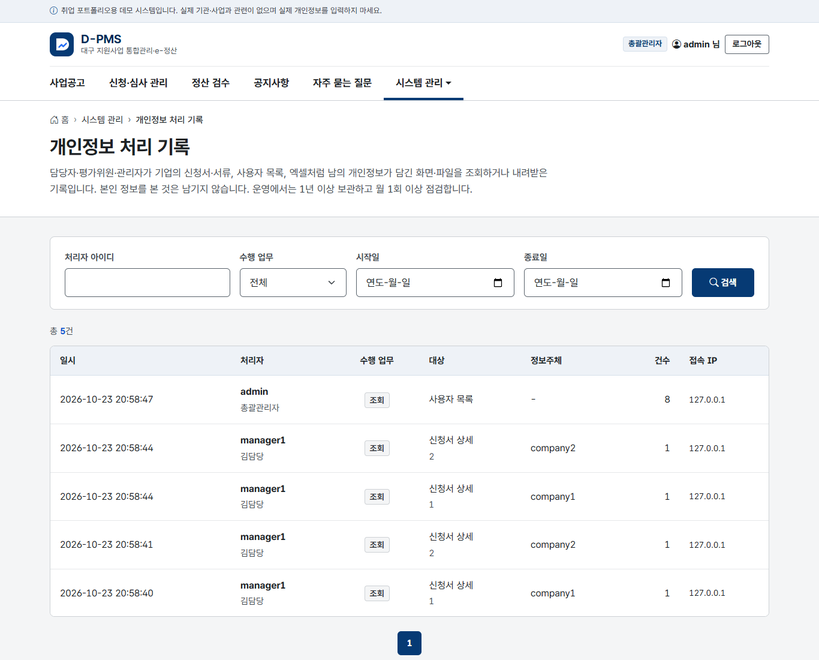

# 11차 스프린트 — 개인정보 처리 기록

작업일: 2026-10-23 · 브랜치: `feature/sprint11-privacy-access-log` · 이전 문서: [10차 스프린트](SPRINT10_APPLICATION_DRAFT.md)

## 한눈에 보기

- 담당자·평가위원·관리자가 **남의 개인정보가 담긴 화면·파일을 조회하거나 내려받으면** 기록이 남는다. 본인 정보를 본 것은 남기지 않는다.
- 기록 항목: 처리자, 일시, 접속 IP, 수행 업무(조회·다운로드), 대상, 정보주체, 건수. 「개인정보의 안전성 확보조치 기준」의 접속기록 항목에 맞췄다.
- 총괄관리자는 시스템 관리 > **개인정보 처리 기록**에서 처리자·업무·기간으로 찾아 점검한다.

## 1. 범위

로그인·로그아웃은 5차부터 `login_history` 에 남기고 있었다. 이번에는 로그인한 뒤 "누가 누구의 정보를 봤는지"를 남긴다. 원래 계획한 공고 마감 배치의 eGov 배치 전환은 다음 작업으로 넘겼다(7절).

## 2. 무엇을 남기나

| 대상 | 언제 | 정보주체 | 건수 |
| :--- | :--- | :--- | :--- |
| 신청서 상세 | 담당자·평가위원이 기업 신청서를 열 때 (기업 본인은 제외) | 신청 기업 아이디 | 1 |
| 첨부파일 | 담당자·평가위원이 사업계획서·정산 증빙을 내려받을 때 | (파일 ID·순번으로 추적) | 1 |
| 신청 현황 엑셀 | 담당자·관리자가 엑셀을 내려받을 때 | 여러 기업이라 비움 | 엑셀 행 수 |
| 사용자 목록 | 총괄관리자가 사용자 관리를 열 때 (연락처는 가려서 보이지만 개인정보 목록) | 비움 | 화면에 나온 수 |

검증: `PrivacyAccessLogIntegrationTest` 5건 (처리자·정보주체·IP·일시, 평가위원, 엑셀·목록 건수, 파일, 본인 열람 미기록, 관리자 전용 화면). 테스트 233건 → 238건.

## 3. 정한 것

**① 기록은 컨트롤러에서, 별도 쓰기 서비스로.** 신청서 조회 서비스는 `select*` 라 읽기 전용 트랜잭션에서 실행된다. 그 안에서 INSERT 하면 MySQL 이 `Connection is read-only` 로 거부한다(6차에 공통컴포넌트 조회수로 겪은 규칙). 그래서 컨트롤러가 조회를 마친 뒤 `insertPrivacyAccess` 를 따로 부른다. 이 메서드는 `insert*` 라 쓰기 트랜잭션이다.

**② 처리자와 일시는 서버가 정한다.** 처리자는 로그인 정보, 일시는 업무 시계(`#{audit.now}`), 접속지는 요청 IP 다. 화면에서 받는 값은 없다.

**③ 본인 열람은 남기지 않는다.** 기업이 자기 신청서·파일을 보는 것은 개인정보 "처리"가 아니라 본인 확인이다. 기록이 쌓이면 점검이 어려워지므로 남의 정보를 본 경우만 남긴다.

**④ 화면은 점검하기 쉽게.** 처리자 아이디·업무·기간으로 검색하고, 다운로드는 다른 색으로 표시한다. 운영에서는 이 화면을 월 1회 이상 점검하고 1년 이상(대상에 따라 2년) 보관한다. 데모에는 보관 기간 정리 작업을 두지 않았다.

## 4. 검증

- `./mvnw clean verify` — 238건 성공
- 실제 앱 (로컬 개발 DB, V6 적용) — 담당자로 신청서 2건 열람, 총괄관리자로 사용자 관리 열람 뒤 처리 기록 화면에 처리자·대상·정보주체·건수·IP 가 나오는지 확인. 화면 8건(1366·390px) 가로 넘침·이름 없는 입력·콘솔 오류 0

## 5. 남은 일

- [ ] 공고 마감 배치를 eGov 배치(Spring Batch 기반)로 옮기기 — 잡 메타데이터 테이블(Flyway), 잡·스텝 구성, 실행 이력 화면
- [ ] 처리 기록 보관 기간이 지난 기록 정리, 월간 점검 결과 남기기
- [ ] 처리 기록 자체의 위·변조 방지 (별도 저장소 전송, 삭제 권한 분리)
