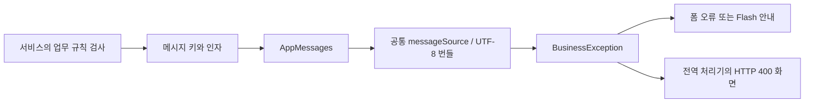
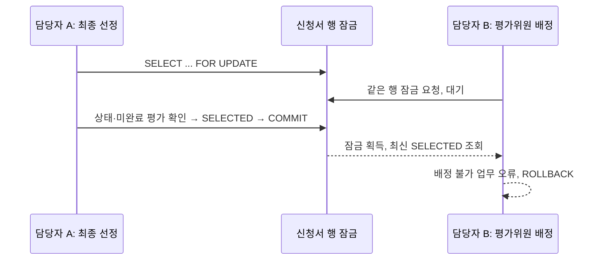

# 4차 스프린트 — 메시지 외부화와 업무 무결성 보완

작업 시작: 2026-10-21 · 최종 로컬 검증: 2026-10-22 · 10월 21일 학습 기록의 **3부** · 브랜치: `codex/sprint4-messages-security`

## 1. 이번 범위를 정한 이유

이전 스프린트는 eGovFrame 5.0 실행환경 전환까지 완료했다. 후속 로드맵에서 1순위였던 서비스 메시지 외부화를 진행하면서, 기존 코드와 테스트를 다시 검토했다. 메시지 표현만 바꾸는 작업에 그치지 않고 실제로 발견한 권한·경쟁 상태·금액 계산·로그 노출 결함을 함께 수정했다.

개인정보 암호화, 회원가입과 로그인 잠금, 신청 임시저장, 감사 로그, 공통 레이아웃, MariaDB/Flyway는 후속 후보다. 이번 PR에서 구현된 기능으로 소개하지 않는다.

## 2. 정밀 검토 결과와 수정

| 영역 | 기존 동작과 위험 | 수정 | 검증 위치 |
| :--- | :--- | :--- | :--- |
| 메시지 | 서비스마다 한글 문구와 금액 포맷을 직접 조합 | `AppMessages`가 공통 `messageSource`로 키·인자를 해석 | `MessageIntegrationTest` |
| 심사 동시성 | 상태 조회와 변경 사이에 다른 요청이 평가를 배정하거나 종료 상태를 변경할 수 있음 | 상태 변경·평가 배정·채점이 동일 신청서 행을 `FOR UPDATE`로 잠근 뒤 규칙 검사 | `WorkflowConcurrencyIntegrationTest` |
| 공고 인가 | URL/컨트롤러에는 역할 검사가 있으나 서비스 직접 호출에는 없음 | `insertAnnouncement` 첫 단계에서 담당자/관리자 검사 | `ServiceAuthorizationIntegrationTest` |
| 정산 금액 | 양수 `long` 공급가액에 부가세를 더하면 오버플로로 음수 합계가 생겨 잔액 비교를 통과할 수 있음 | 서비스에서 양수 검사, `Math.addExact`로 합계 범위 검사, 파일 저장 전 거부 | `SettlementAmountSecurityIntegrationTest` |
| 로그 | 업무 패키지 DEBUG가 MyBatis SQL 바인딩 값을 출력 | YAML과 Log4j2 모두 INFO 기본값 | `SqlLoggingSecurityIntegrationTest` |

기존 보안 경계도 함께 확인했다. SQL 값은 MyBatis `#{}`로 바인딩하고, 화면 데이터는 Thymeleaf가 이스케이프한다. 파일 다운로드는 연결된 과제의 권한을 다시 검사하며 파일명과 저장 경로를 분리한다. 상태 변경 요청에는 CSRF 검사가 적용된다. 기존 IDOR·CSRF·파일 위조·중복 채점·예산 초과 테스트를 전체 회귀 검증에 포함한다.

이 검토는 소스와 실행 테스트를 통한 프로젝트 개선이다. 외부 모의침투, 모든 라이브러리 취약점 진단, 운영 인증이나 법적 준수 확인을 수행했다는 의미는 아니다.

## 3. 메시지 외부화 읽는 순서

1. `src/main/resources/egovframework/message/message-common.properties` — 업무별 키와 문구
2. `src/main/java/kr/go/daegu/pms/config/EgovConfigCommon.java` — UTF-8 번들과 eGov 기본 번들을 등록하는 설정
3. `src/main/java/kr/go/daegu/pms/cmm/message/AppMessages.java` — 공통 조회와 예외 생성
4. `src/main/java/kr/go/daegu/pms/settlement/service/impl/SettlementServiceImpl.java` — 금액을 인자로 전달하는 실제 사용 예
5. `src/main/java/kr/go/daegu/pms/cmm/exception/GlobalExceptionHandler.java` — 예외와 HTTP 응답의 연결



### `processException`을 그대로 쓰지 않은 이유

eGov의 `processException`은 기본적으로 체크 예외인 `EgovBizException`을 만든다. 현재 프로젝트는 `BusinessException`이라는 런타임 예외를 사용하고, 컨트롤러와 eGov 예외 후처리에서 이 타입을 구분한다. 문구 외부화 때문에 예외 타입까지 바꾸면 기존 400 응답이 시스템 장애로 처리되거나 선언하지 않은 체크 예외 문제가 생길 수 있다.

따라서 eGov 공통 설정의 **동일한 `messageSource`를 재사용**하고 런타임 예외 계약을 유지한다. 데이터 없음은 `NotFoundException`, 권한 없음은 `AccessDeniedException`으로 구분한다. 기존 서비스의 `EgovAbstractServiceImpl` 상속도 유지한다. [eGov 공식 예외 처리 안내](https://www.egovframe.go.kr/wiki/doku.php?id=egovframework%3Arte%3Absl%3Aexception_handling)

### 인자와 로케일

- 번들은 UTF-8이다. 금액·날짜·상태 이름을 문구와 분리한다.
- 한국어 서비스의 숫자 표현을 안정적으로 유지하기 위해 한국 로케일을 사용한다. 영어 번역을 구현한 것은 아니다.
- `MessageFormat`에서 작은따옴표는 특수문자이므로 상태 이름 양옆에 표시하려면 번들에서 `''`로 쓴다.
- 키가 없으면 키 이름을 화면에 표시하는 fallback을 두지 않는다. 누락은 테스트에서 실패하게 한다.
- 이번 범위는 서비스의 사용자 예외와 컨트롤러 안내다. VO의 Bean Validation 문구, 화면 정적 라벨, 개발자 진단 로그 전체를 외부화한 것은 아니다.

## 4. 경쟁 상태: 트랜잭션만 있다고 해결되지는 않는다

기존 최종 선정은 `현재 상태 조회 → 미완료 평가 수 조회 → SELECTED 저장`이었다. 두 요청 모두 트랜잭션이어도, 그 사이에 다른 트랜잭션이 평가위원을 추가하면 **미완료 평가가 있는 선정 과제**가 생길 수 있다.



공통 규칙은 **신청서 행을 먼저 잠그고, 그 뒤 평가표/정산을 처리**하는 것이다. 잠금 순서를 통일하면 서로 반대 순서로 잠그는 교착 위험을 줄일 수 있다. 잠금은 서비스 트랜잭션이 끝날 때 해제된다.

Mapper의 `selectApplicationForUpdate`라는 이름은 문제가 없다. 트랜잭션 이름 규칙은 서비스 구현체에 적용되고, 이 Mapper는 쓰기 서비스 `updateApplicationStatus`, `assignEvaluator`, `submitScore`, `insertSettlement`의 트랜잭션 안에서 호출된다.

동시성 테스트는 서로 다른 스레드·커넥션·트랜잭션을 사용한다. H2 `INFORMATION_SCHEMA.SESSIONS.BLOCKER_ID`로 두 번째 요청이 실제 잠금을 기다리는지 확인한 뒤 첫 트랜잭션을 커밋하고 결과를 검사한다. 하나의 테스트 트랜잭션 안에서 순서대로 두 번 호출하는 테스트와 다르다. H2에서 확인한 결과이며 MariaDB의 격리 수준·잠금 대기는 DB 전환 때 별도로 검증해야 한다.

## 5. 정산 금액과 로그 보호

### 양수 두 개의 합이 음수가 될 수 있다

Java `long`은 표현 범위가 정해져 있다. 입력한 공급가액이 `@Positive`를 통과해도 부가세를 더한 결과까지 안전한 것은 아니다. `Math.addExact`는 범위를 넘으면 `ArithmeticException`을 던지므로, 이를 사용자 안내용 업무 예외로 바꾸고 DB/파일 저장 전에 중단한다. 기존 정상 금액의 부가세 10% 및 원 미만 절사 규칙은 유지한다. [Java 17 Math API](https://docs.oracle.com/en/java/javase/17/docs/api/java.base/java/lang/Math.html)

### SQL 바인딩은 로그 비밀성을 보장하지 않는다

`#{}`는 SQL 삽입을 막는 값 바인딩 방법이다. 로그에 값이 기록되는지는 별도 설정이다. MyBatis는 Mapper 로거 설정에 따라 SQL과 결과를 기록하므로 업무 패키지 전체를 DEBUG로 켜면 입력값까지 로그에 나타날 수 있다. [MyBatis 공식 로깅 문서](https://mybatis.org/mybatis-3/logging.html)

기본값을 INFO로 낮추되 업무 처리 ID와 결과를 알 수 있는 기존 INFO 이벤트는 유지한다. 테스트는 고유한 가짜 민감 문자열을 사업계획 요약·평가 의견·정산 적요·반려 사유로 실제 저장하고, 로그에 해당 문자열이 없는지 검사한다. INFO 이벤트가 존재하는지도 확인하므로 모든 로그를 꺼서 통과시킬 수 없다.

이 변경은 기본 설정의 정상 처리 경로를 보호한다. 외부 설정에서 DEBUG/TRACE를 다시 켜거나 시스템 장애의 예외 원문을 별도로 수집하면 노출 위험이 다시 생길 수 있다. 운영 로그의 수집·권한·마스킹·보존 정책과 공통 감사 이력은 후속 과제다. 이전 로컬 테스트 보고서에는 옛 DEBUG 출력이 남아 있을 수 있으므로 이를 공개 자료로 올리지 않는다.

## 6. 검증과 Git 흐름

Windows에서 전체 빌드·회귀 테스트:

```powershell
.\mvnw.cmd -B -ntp clean verify
```

주요 보안 회귀 테스트만 실행:

```powershell
.\mvnw.cmd -B -ntp '-Dtest=WorkflowConcurrencyIntegrationTest,ServiceAuthorizationIntegrationTest,SettlementAmountSecurityIntegrationTest,SqlLoggingSecurityIntegrationTest' test
```

기존 PR #1과 #2의 병합을 확인하고 최신 `main`에서 이번 기능 브랜치를 만들었다. 한국어 커밋으로 검증된 변경을 구분한 뒤 기능 브랜치만 푸시하고 `main` 대상 PR로 검토한다. `PROJECT_CONTEXT.md`, `NOTION_*.md`, 빌드 산출물, 업로드 파일은 Git에 포함하지 않는다.

최종 로컬 검증 결과(2026-10-22):

- `clean verify` **78건 성공**, 실패/오류/건너뜀 0건. 기존 58건에 20건 추가.
- 신규 검증: 메시지 6, DB 동시성 4, 서비스 인가 4, 정산 경계값 5, 로그 비노출 1.
- 실행 JAR를 `127.0.0.1:18080`에 기동하여 4개 역할의 실제 폼 로그인과 세션을 검증.
- 실제 HTTP 요청으로 신청서 권한 403, 업무 오류 400, 데이터 없음 404, CSRF 없는 POST 403 확인.
- 정산 오버플로·잘못된 상태 전이·점수 누락의 한국어 안내가 실제 렌더링된 HTML에 표시됨을 확인.
- 브라우저 육안 검사 대신 실제 서버 HTTP 응답과 HTML을 검사했다. MariaDB·운영 배포·외부 침투검사는 이번 검증 범위 밖이다.

원격 CI 결과와 변경 검토는 이 브랜치의 `main` 대상 PR에 기록한다. 검토 후 병합하는 흐름이며 이 작업에서 main을 직접 변경하지 않는다.

## 7. 학습 과제와 다음 순서

1. 메시지 문구 한 줄을 바꾸고 테스트를 실행해 코드와 문구가 어떻게 분리되는지 확인한다.
2. 메시지 키를 일부러 틀리게 입력하고 누락 테스트가 실패하는 이유를 설명한다. 실습 후 복구한다.
3. 상태 변경·평가 배정 코드에서 같은 신청서 잠금을 찾고, 어느 순간에 잠금이 해제되는지 설명한다.
4. `Long.MAX_VALUE`를 공급가액으로 입력했을 때 `@Positive`와 합계 범위 검사가 각각 무엇을 검사하는지 비교한다.
5. 후속 개인정보 암호화 작업은 컬럼 용량·암호키 주입/회전·기존 데이터 전환·화면/엑셀 마스킹 범위를 먼저 설계한다. 키를 저장소에 넣지 않는다.
6. 회원가입/잠금, 임시저장, 감사 로그, 운영 DB는 각각 업무 규칙과 위협 시나리오를 정한 후 별도 PR로 진행한다.
