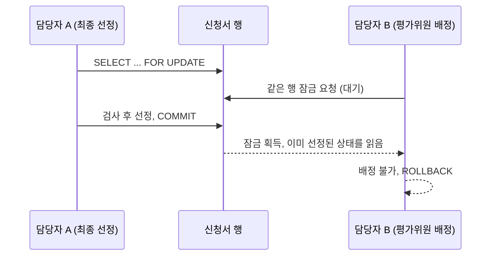

# 4차: 메시지 정리와 보안 보완

2026-10-21~22, 브랜치 `codex/sprint4-messages-security`

원래 목표는 서비스 곳곳에 있던 안내 문구를 메시지 번들로 옮기는 것이었다. 그런데 코드를 다시 읽다 보니 권한, 동시 요청, 금액 계산, 로그에서 고칠 것이 보여서 같이 고쳤다.

## 메시지 번들

서비스에서 직접 만들던 한글 문구를 `message-common.properties` 로 옮기고, `AppMessages` 가 키와 인자로 문구를 찾게 했다. 번들은 eGov 공통 설정의 `messageSource` 를 그대로 쓴다.

eGov 의 `processException` 은 쓰지 않았다. 이 메서드는 체크 예외(`EgovBizException`)를 만드는데, 프로젝트는 이미 런타임 예외(`BusinessException`)로 "사용자 안내(400)"와 "장애"를 나누고 있었다. 문구 때문에 예외 종류까지 바꾸면 이 구분이 깨진다.

번들에 없는 키를 쓰면 화면에 키 이름이 나오는 대신 테스트가 실패한다.

## 동시 요청은 트랜잭션만으로 막히지 않는다

최종 선정은 "상태 확인, 남은 평가 확인, 선정 저장" 순서였다. 각 요청이 트랜잭션이어도, 그 사이에 다른 담당자가 평가위원을 배정하면 평가가 끝나지 않은 과제가 선정될 수 있다.

그래서 상태 변경, 평가위원 배정, 채점 모두 신청서 행을 먼저 `SELECT ... FOR UPDATE` 로 잠그고 검사하게 했다. 잠그는 순서를 하나로 맞춰 두면 교착 상태 위험도 줄어든다.

테스트는 두 요청을 다른 스레드와 커넥션에서 실행하고, 두 번째 요청이 실제로 잠금을 기다리는 것을 DB 에서 확인한 뒤 첫 요청을 커밋한다.

## 양수 두 개를 더해도 음수가 될 수 있다

공급가액이 `@Positive` 를 통과해도, 부가세를 더하다 `long` 범위를 넘으면 합계가 음수가 된다. 음수 합계는 잔액 비교를 그냥 통과한다. `Math.addExact` 로 범위를 넘으면 업무 오류로 막고, 파일을 저장하기 전에 멈추게 했다.

## 로그에 입력값이 남던 문제

`#{}` 바인딩은 SQL 삽입을 막아 줄 뿐이고, 로그에 값이 찍히는 것은 별개다. 업무 패키지를 DEBUG 로 켜 두면 MyBatis 가 입력값까지 출력한다. 기본 로그 레벨을 INFO 로 낮췄다. 테스트는 가짜 민감 문자열을 실제로 저장한 뒤 로그에 그 문자열이 없는지 본다.

## 그 밖에

- 공고 등록 서비스를 직접 부르면 권한 검사가 없던 것을, 서비스 첫 단계에서 담당자·관리자인지 확인하게 했다.

## 확인

- 테스트 78건 통과 (20건 추가)
- 실행 JAR 을 띄워 역할별 로그인, 남의 신청서 403, 업무 오류 400, CSRF 없는 POST 403 을 실제 요청으로 확인
