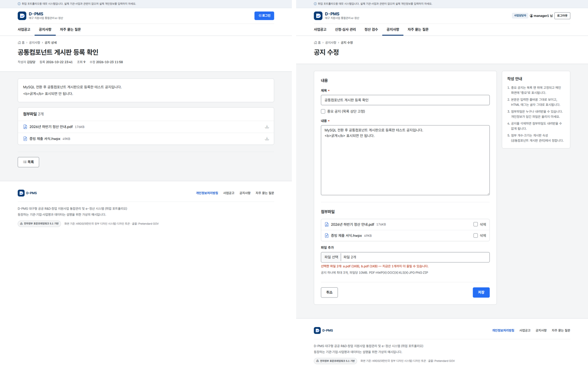

# 8차: 공지사항 첨부파일

2026-10-23, 브랜치 `feature/sprint8-notice-attachments`

6차에 공지사항을 공통컴포넌트 게시판으로 옮기면서 첨부파일은 미뤄 뒀다. 이번에 게시판과 첨부파일 공통컴포넌트를 연결해서 공지에 파일을 붙일 수 있게 했다.

- 공지 하나에 3개, 파일당 10MB
- 공지 첨부는 로그인하지 않아도 받을 수 있다. 삭제된 공지의 파일은 받을 수 없다

왼쪽은 로그인하지 않고 연 공지 상세, 오른쪽은 담당자 수정 화면이다. 한도를 넘게 고르면 바로 알려 주고, 무시하고 저장해도 서버가 같은 규칙으로 거부한다.

## 규칙은 게시판 속성에 둔다

공통컴포넌트 게시판은 게시판마다 첨부 가능 여부, 개수, 크기를 속성으로 가진다(`COMTNBBSMASTER`). 서비스가 이 값을 읽어서 검사하기 때문에, 첨부를 막고 싶으면 코드를 고치지 않고 값만 바꾸면 된다. 테스트에서 실제로 값을 바꿔 업로드가 거부되는 것을 확인했다.

## 첨부 ID 는 화면에서 받지 않는다

첨부파일 ID 는 `FILE_` + 순번이라 쉽게 추측할 수 있다. 화면이 보낸 값을 믿으면 남의 첨부 묶음을 내 공지에 붙일 수 있다. 그래서 등록할 때는 새로 만든 묶음을, 수정할 때는 잠근 게시물 행에서 읽은 묶음만 쓴다.

## 순번은 행을 잠그고 매긴다

새 파일 순번은 "지금 최대 순번 + 1" 이다. 두 사람이 같은 공지에 동시에 올리면 같은 순번이 나올 수 있어서, 수정 전에 게시물 행을 `FOR UPDATE` 로 잠근다.

새 파일을 먼저 추가하고 나서 지울 파일을 지운다. 순서를 바꾸면 마지막 파일을 지웠을 때 새 파일이 같은 순번을 받아서, 예전 다운로드 주소가 다른 파일을 가리키게 된다.

## 다 검사하고 나서 저장한다

세 번째 파일이 형식 오류면 앞의 두 파일도 저장하지 않는다. 저장하다 오류가 나면 트랜잭션 롤백과 함께 디스크에 쓴 파일도 지운다.

## 공통컴포넌트에서 고친 것

원본의 첨부 삭제(`EgovFileMngServiceImpl.deleteFileInf`)는 DB 행을 지우기 전에 실제 파일부터 지운다. 같은 요청에서 뒤에 오류가 나서 롤백되면 DB 에는 있는데 파일은 없는 상태가 된다. 커밋이 끝난 뒤에 파일을 지우도록 바꿨다.

## 확인

- 테스트 166건 통과 (10건 추가)
- 로그인하지 않고 받은 파일이 원본과 바이트 단위로 같은지 비교
- 수정 화면에서 기존 파일 삭제와 새 파일 추가를 같이 했을 때 새 파일이 다음 순번으로 저장되는지 확인
- Windows 의 curl 로 올리면 한글 파일 이름이 깨진다(로컬 코드페이지로 보내기 때문). 브라우저는 UTF-8 로 보내서 점검은 브라우저로 했다

## 남은 것

- 첨부파일 바이러스 검사
- 지운 순번을 다시 쓰지 않게 하기
