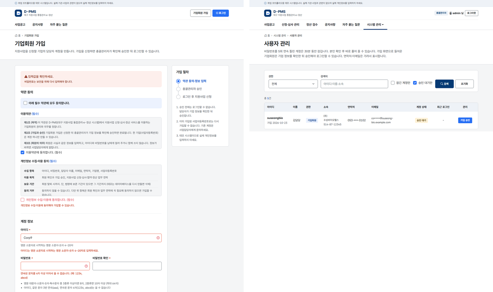

# 9차 스프린트 — 기업회원 가입

작업일: 2026-10-23 · 브랜치: `feature/sprint9-company-signup` · 이전 문서: [8차 스프린트](SPRINT8_NOTICE_ATTACHMENTS.md)

## 한눈에 보기

- 기업이 직접 가입한다. 이용약관·개인정보 수집·이용 동의 → 계정·기업·담당자 정보 입력 → 가입 신청.
- 가입은 **승인 대기**로 저장되고, 총괄관리자가 기업 정보를 확인해 승인해야 로그인된다. 공통컴포넌트 기업회원과 같은 흐름이다.
- **한 사업자등록번호에 기업회원 하나.** 공고 중복 신청 검사가 계정 단위라서, 계정을 둘 만들어 같은 공고에 두 번 신청하는 길을 막는다.



왼쪽은 가입 화면에서 규칙을 어긴 입력을 보냈을 때다. 어긴 칸마다 이유를 보여 주고, 비밀번호 칸은 비운다. 오른쪽은 총괄관리자의 사용자 관리에서 "승인 대기만"을 고른 화면이다.

## 1. 범위

8차까지는 데모 계정으로만 들어갈 수 있었다. 이번에 기업이 스스로 가입하고, 관리자가 승인하는 흐름을 만들었다. README 의 "아직 구현하지 않은 기능"에서 회원가입이 빠졌다.

이번 범위 밖: 담당자·평가위원 계정 만들기(관리자 화면), 비밀번호 변경·찾기, 회원 탈퇴. 7절에 남겼다.

## 2. 바뀐 것

| 영역 | 이번 | 검증 |
| :--- | :--- | :--- |
| 가입 화면 `/signup` | 비로그인만. 로그인한 상태로 열면 메인으로 | `signupPageForAnonymousOnly` |
| 저장 | 기업회원·승인 대기, 비밀번호 BCrypt, 이메일·연락처 ARIA, 번호 형식 통일, 동의 일시 | `signupStoresPendingCompanyMember` |
| 로그인 | 승인 전에는 맞는 비밀번호도 거부, "가입 승인을 기다리는 계정" 안내, 접속 기록 `PENDING` | `pendingMemberLogsInOnlyAfterApproval` |
| 승인 | 사용자 관리 "승인 대기만" + 가입 승인 버튼, 메인 처리할 일 "가입 승인 대기" | `pendingMemberLogsInOnlyAfterApproval`, `adminApproval` |
| 입력 규칙 | 아이디·비밀번호·사업자등록번호·이메일·연락처·필수 동의를 칸별로 안내 | `rejectsInvalidInputPerField`, `userIdRules`, `passwordRules`, 단위 테스트 47건 |
| 중복 | 사업자등록번호는 기업회원끼리 하나 (서비스 확인 + DB UNIQUE) | `oneAccountPerBusinessNo`, `databaseUniqueOnlyAmongCompanies` |
| 대량 할당 | 요청에 `role`·`approvalStatus`·`termsAgreedAt` 를 넣어도 무시 | `serverDecidesRoleAndApproval` |
| 데모 데이터 | 기업회원 번호 2개의 검증번호를 맞춤 (V4_1, local·test 전용) | `seedCompanyBusinessNumbersAreValid` |
| 안내 문서 | 개인정보처리방침에 가입 수집 항목·동의 기록·승인 절차 | 화면 |

테스트 166건 → 224건 (단위 47건, 통합 11건).

## 3. 흐름

```text
[가입]   /signup (비로그인) ─▶ CompanySignupController ─▶ CompanySignupServiceImpl
                                                         ├ 칸별 규칙 확인 → 어긴 칸을 모아 FieldBusinessException
                                                         ├ 비밀번호 BCrypt, 이메일·연락처 ARIA
                                                         └ INSERT: ROLE_COMPANY·REQUESTED·동의 일시는 SQL 이 정함
[승인]   /admin/users?pendingOnly=Y ─▶ 가입 승인 (총괄관리자) ─▶ APPROVED + 승인자·승인 일시
[로그인] CustomUserDetailsService: 승인 전이면 enabled=false
         └▶ LoginFailureHandler: 승인 대기인지 사용 중지인지 다시 확인해 안내와 접속 기록을 나눔
```

## 4. 정한 것

**① 가입하면 승인 대기, 관리자가 승인한다.** 본인인증이나 국세청 사업자 상태 조회를 붙이지 않았으니, 실제로 있는 기업인지는 사람이 확인해야 한다. 공통컴포넌트 원본(v5.0.7 `EgovEntrprsManageController`)도 기업회원 가입을 신청 상태(`ENTRPRS_MBER_STTUS = 'A'`)로 저장하고 관리자가 승인한다. 승인 상태는 `users.approval_status` 로 두고, 기존 계정은 기본값 `APPROVED` 로 그대로 쓴다.

**② 한 기업은 계정 하나.** 같은 기업이 계정을 둘 만들면 "같은 공고에 한 번만 신청" 검사를 피할 수 있다. 다만 담당자·평가위원은 같은 기관이면 번호가 같을 수 있다. MySQL 에는 조건부 인덱스가 없어서, 기업회원일 때만 번호가 들어가는 생성 컬럼(`company_business_no`)에 UNIQUE 인덱스를 걸었다. 서비스가 먼저 확인해 안내하고, 동시에 들어온 가입은 DB 가 막는다.

**③ 입력 규칙은 서비스 한 곳에서.** 아이디·비밀번호·번호 같은 규칙을 Bean Validation 과 서비스에 나눠 두지 않고 서비스가 모두 확인한다. 어긴 칸을 모아 한 번에 돌려주므로 사용자는 한 번에 고칠 수 있고, 화면을 거치지 않는 호출도 같은 규칙을 지난다. 권한·승인 상태는 입력 VO 에 필드 자체가 없고 INSERT SQL 에 고정돼 있다.

**④ 비밀번호.** KISA 「패스워드 선택 및 이용 안내서」의 조합·길이 기준(3종류 8자, 2종류 10자)에 아이디 포함·같은 문자 3번 연속·연속 문자 4자 금지를 더했다. 최대 64자인 이유는 BCrypt 가 앞 72바이트만 쓰기 때문이다. 한글·공백을 받지 않아 한 글자가 1바이트가 된다. 오류로 화면을 다시 보여 줄 때 비밀번호 칸은 비운다.

**⑤ 사업자등록번호.** 하이픈 유무와 관계없이 `000-00-00000` 으로 맞춘 뒤 검증번호를 계산한다. 앞 9자리에 가중치 1,3,7,1,3,7,1,3,5 를 곱해 더하고 9번째 자리 × 5 ÷ 10 의 몫을 더한 뒤, 10 에서 끝자리를 뺀 값이 마지막 자리와 같아야 한다. 휴·폐업 여부는 국세청 연계가 필요해서 승인할 때 담당자가 확인한다.

**⑥ 드러나는 정보.** "이미 사용 중인 아이디"와 로그인의 "승인 대기" 안내는 그 아이디가 있다는 것을 알려 준다. 가입 화면에서는 피할 수 없는 정보라 안내를 우선했다. 로그인 실패 문구는 전처럼 아이디 오류와 비밀번호 오류를 구분하지 않는다. 자동 가입이나 대량 조회를 막으려면 요청 횟수 제한이 필요하다(7절).

## 5. 공통컴포넌트 기업회원과 비교

| 항목 | 공통컴포넌트 (`uss.umt`) | D-PMS |
| :--- | :--- | :--- |
| 회원 테이블 | 기업회원 전용 `COMTNENTRPRSMBER` (일반회원·업무사용자는 다른 테이블) | `users` 한 테이블 + 권한(role) |
| 가입 | `/uss/umt/EgovEntrprsSbscrb.do`, 상태 `A`(신청)로 저장 | `/signup`, `approval_status = REQUESTED` |
| 약관 | 약관 테이블(`COMTNSTPLATINFO`)에서 읽어 확인 화면 | 화면에 약관 문구, 동의 일시를 회원 행에 저장 |
| 비밀번호 저장 | `EgovFileScrty.encryptPassword`: 아이디를 솔트로 SHA-256 한 번 | BCrypt (반복 계산으로 느리게 만든 해시) |
| 사업자등록번호 | `BIZRNO` 컬럼에 저장 | 형식·검증번호 확인, 기업회원끼리 중복 금지 |

로그인·권한 공통컴포넌트를 쓰지 않은 이유(6차)와 같은 이유로 테이블은 가져오지 않았고, 승인 흐름만 원본과 맞췄다.

## 6. 검증

- `./mvnw clean verify` — 규칙 커밋 213건, 가입 기능 커밋 224건 성공
- 실제 앱 (로컬 개발 DB, V4·V4_1 적용) — 헤드리스 Chrome 으로 가입 화면에서 직접 입력·제출
  - 규칙을 어긴 입력 → 칸별 안내 7개, 비밀번호 칸 비움
  - 정상 입력 → 로그인 화면 "가입 신청을 받았습니다" → 같은 계정으로 로그인 시 "승인 대기" 안내
  - 총괄관리자 메인 "가입 승인 대기 1" → 사용자 관리에서 승인 → 새 계정으로 로그인, 내 정보에 동의·승인 일시
- 화면 점검 21건 — 가입·로그인·개인정보처리방침 1366·390px 6건, 가입 흐름 8단계, 사용자 관리·접속 기록 1366·390px 4건, 승인 대기 시연 3건. 가로 넘침·이름 없는 입력·콘솔 오류 0

## 7. 남은 일

- [ ] 비밀번호 변경·찾기 (PasswordPolicy 재사용), 회원 탈퇴와 탈퇴 시 개인정보 파기
- [ ] 가입 반려(사유 안내)와 오래 방치된 승인 대기 계정 정리
- [ ] 가입 요청 횟수 제한(자동 가입 방지)
- [ ] 동시 가입 경쟁에서 DB 중복 오류를 안내 문구로 바꾸는 경로의 테스트 (지금은 DB 제약만 테스트)
- [ ] 약관 버전 관리 (약관이 바뀌면 다시 동의 받기)
- [ ] 국세청 사업자 상태 조회 연계 (휴·폐업 확인)
