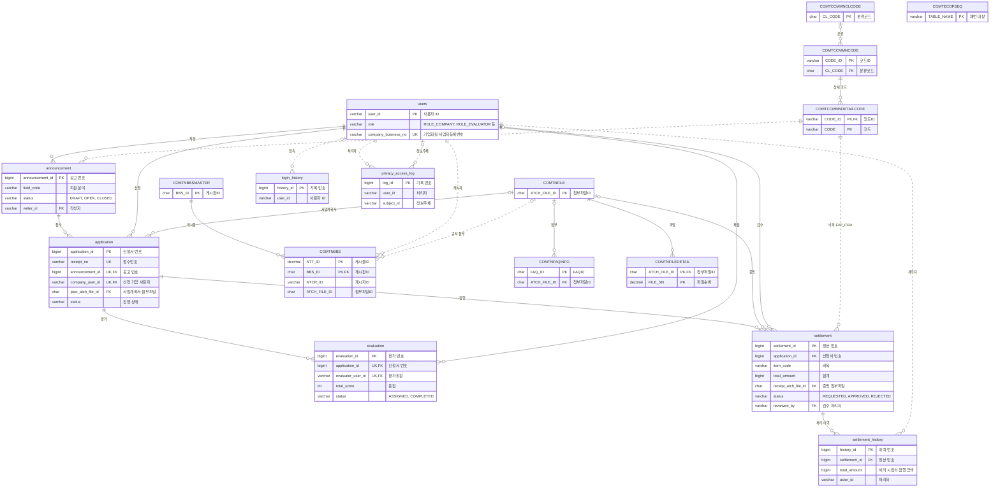
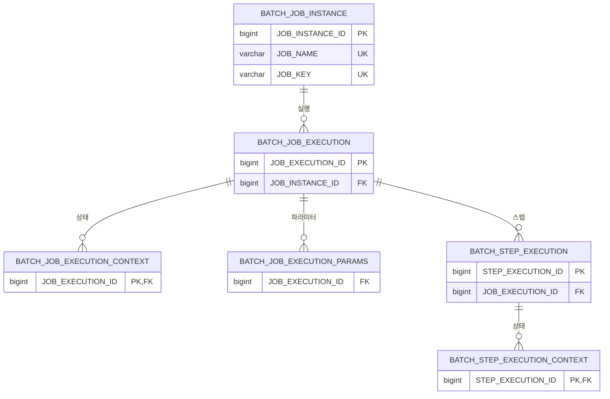

# ERD

> 이 문서는 `scripts/generate-db-docs.py` 가 실제 DB 의 외래키와 컬럼 설명으로 만든다. 실선은 외래키, 점선은 외래키 없이 값으로 잇는 관계다.

- 기준: Flyway V7 적용 DB, 생성일 2026-10-26
- 칸에는 키 컬럼과 상태 같은 핵심 컬럼만 그렸다. 전체 컬럼은 [테이블 정의서](TABLE_DEFINITION.md) 에 있다

## 1. 업무와 공통컴포넌트

## 2. 배치 메타데이터

## 3. 외래키 없이 잇는 관계

| 관계 | 컬럼 | 외래키를 두지 않은 이유 |
| :--- | :--- | :--- |
| users → login_history (접속) | `login_history.user_id` | 접속기록은 계정과 묶지 않아 계정을 정리해도 남는다. 없는 아이디로 실패하면 비운다 |
| users → privacy_access_log (처리자) | `privacy_access_log.user_id` | 처리 기록은 계정과 묶지 않아 계정을 정리해도 남는다 |
| users → privacy_access_log (정보주체) | `privacy_access_log.subject_id` | 같은 이유. 여러 기업이 담긴 엑셀·목록은 비운다 |
| users → settlement_history (처리자) | `settlement_history.actor_id` | 처리 이력은 계정과 묶지 않아 계정을 정리해도 남는다 |
| users → COMTNBBS (게시자) | `COMTNBBS.NTCR_ID` | 공통컴포넌트 원본 DDL 에 외래키가 없다 |
| COMTCCMMNDETAILCODE → announcement (분야 FIELD) | `announcement.field_code` | 공통코드 키가 (코드ID, 코드) 두 컬럼이라 외래키 대신 서비스가 공통코드 목록으로 검증한다 |
| COMTCCMMNDETAILCODE → settlement (비목 EXP_ITEM) | `settlement.item_code` | 공통코드 키가 (코드ID, 코드) 두 컬럼이라 외래키 대신 서비스가 공통코드 목록으로 검증한다 |
| COMTNFILE → COMTNBBS (공지 첨부) | `COMTNBBS.ATCH_FILE_ID` | 공통컴포넌트 원본 DDL 에 외래키가 없다 |
